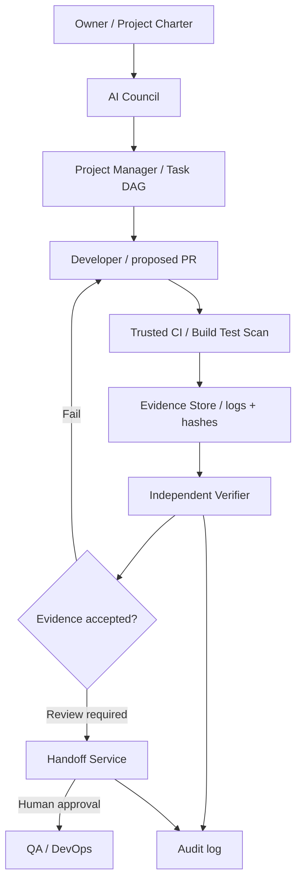

# Architecture V1

**Implemented**: deterministic charter gate, DAG, evidence manifest, fail-closed verification, CLI, and GitHub unit-test CI.

**Not implemented**: live LLM Council, coding agent, repository write adapter, authenticated CI provenance, persisted evidence indexing, identity-separated verifier, durable audit log, automated handoff.

**Trust boundary**: an artifact digest and developer-supplied provenance text are not independently authenticated CI evidence. Verify workflow run identity, conclusion, commit SHA and artifact hashes through a read-only trusted GitHub integration before any release. No live trading or auto merge.
